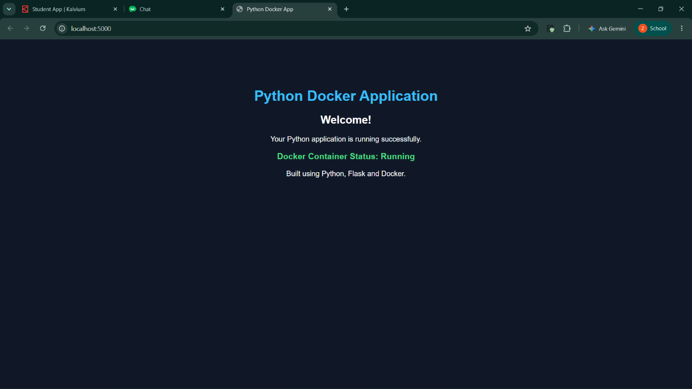
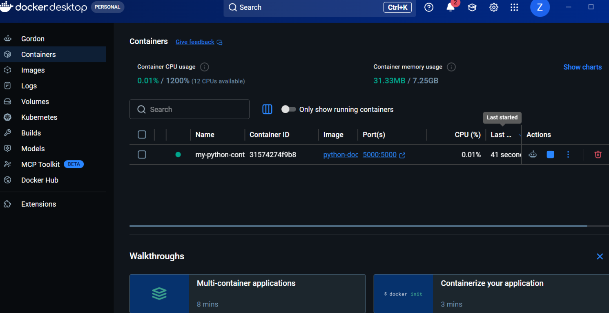

# Python Docker Application

## Description
A simple Python web application built using Flask and containerized using Docker.

## Technologies Used
- Python
- Flask
- Docker
- Git
- GitHub

## Project Structure
- app.py
- requirements.txt
- Dockerfile
- .dockerignore
- README.md
- screenshots/

## Build Docker Image

```bash
docker build -t python-docker-app .
```

## Run Docker Container

```bash
docker run -d -p 5000:5000 --name my-python-container python-docker-app
```

## Access Application

http://localhost:5000

## Health Check

http://localhost:5000/health

## Check Container

```bash
docker ps
```

## Stop Container

```bash
docker stop my-python-container
```

## Screenshots

### Application Running


### Docker Container Running


## Conclusion
The Python web application was successfully containerized using Docker and executed inside a Docker container.
